# SUPER WORK – LIKE MIN

**MIN처럼 생각하는 MPM(MIN-like Project Manager)에게 기획 업무를 지시하는 데스크톱 앱** (macOS · Windows)

MPM은 업무를 받으면 의도를 읽고, **이 일에 필요한 만큼만 공정을 설계**합니다. 이어서 하위 담당 에이전트들에게 업무를 나눠 주고, 그 보고를 **믿지 않고 검수**합니다. 필요하면 Factbook·시뮬레이션·전략 분석을 거쳐 **최소 3개의 대안**을 내고, 결과를 스스로 다시 검증한 뒤 리포트로 전달합니다. 이 모든 과정이 귀여운 에이전트들이 일하는 **아이소메트릭 캠퍼스**로 실시간 시각화됩니다.

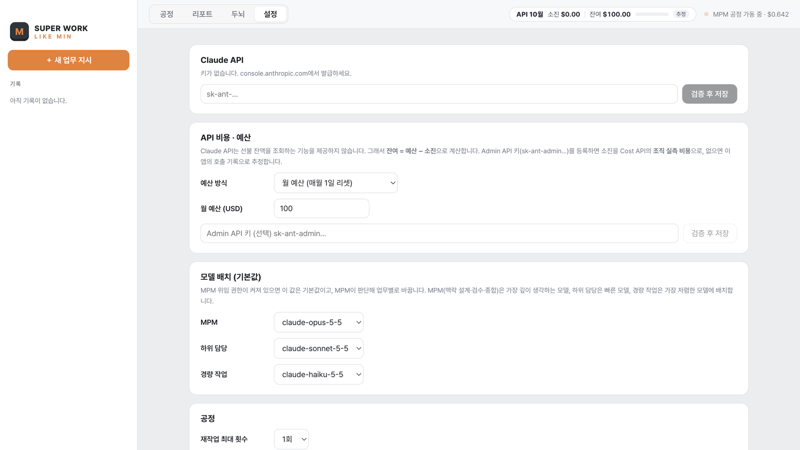

---

## 목차
1. [MPM은 어떤 논리로 일하는가](#1-mpm은-어떤-논리로-일하는가)
2. [설치](#2-설치)
3. [사용법](#3-사용법)
4. [운영에 필요한 것](#4-운영에-필요한-것)
5. [업무 툴 연동](#5-업무-툴-연동)
6. [두뇌(LIKE MIN Brain) 키우기](#6-두뇌like-min-brain-키우기)
7. [개발 · 배포 · 자동 업데이트](#7-개발--배포--자동-업데이트)
8. [구조](#8-구조)

---

## 1. MPM은 어떤 논리로 일하는가

```
 ① 의도 파악·공정 설계 ──▶ ② 분장·위임 ──▶ ③ 담당별 Factbook 조사 + 업무 ⇄ 검수 게이트
                                                      │
 ⑦ 재검증 ◀── ⑥ 전략 종합 ◀── ⑤ SUPER INSIGHT ◀── ④ Factbook 통합 · 타깃 시뮬레이션
        │
        ▼                         [전략 엔진: 무엇이 맞는가]
 ⑦-1 근본 이슈 (맥락 설계 직후 · MIN 확정) ── 모든 안을 대입할 자리
 ⑦-2 콘셉트 회차 ⟲ 걸림 → 깊이·넓이·비틀기·조합 → 대입 → 고르기 → 리뷰 카드(MIN 한마디)
        │
 ⑦-3 고도화 — 회차의 결론을 전략으로 되돌린다 (바뀐 부분만)
        │
 ⑧ 1장 브리프 (회차를 안 돌면: 클론 심사 → MIN 승인)
        │
        ▼                         [제작 엔진: 무엇이 뛰어난가]
 ⑨ 제작(유형별) ──▶ 취향 심사 ──▶ ⑩ 윤문 ──▶ ⑪ 결과물 · 브리프 · 전략 근거
```

| 단계 | MPM이 하는 일 | MIN의 원칙 |
| --- | --- | --- |
| **① 의도 파악 · 공정 설계** | 표면 요청을 허물고 실제 문제를 다시 정의한다. 목표와 목적을 분리하고, 브랜드·소비자·시장을 코어로 둔다. 핵심 주장 가설을 먼저 세운다. 그다음 **이 일의 끝(E2E)에서 무엇이 필요한지 보고 공정의 규모와 구성을 설계한다.** | 의도가 읽히면 **묻지 않고 진행**한다. 정말 모호할 때만, 질문자가 이해하기 쉽게 **비유로** 묻는다. 쥐 잡는 데 소 잡는 칼을 쓰지 않는다. 그렇다고 보수적으로 줄이지도 않는다. |
| **② 분장 · 위임** | 직함이 아니라 **업무 계약**(목적·책임·판단 기준·경계·출력)을 준다. | 설정의 모델은 기본값일 뿐이고, MPM이 판단 난이도를 보고 **모델을 직접 골라 위임**한다. |
| **③ 업무 ⇄ 검수** | 하위 담당은 업무와 별개로 **Factbook**(신뢰할 수 있는 사실·데이터·제품 USP/키피처 2 depth·경쟁사)을 만들고 업무를 수행한다. | MPM은 보고를 **무조건 믿지 않는다.** 사실/추론/가설 분류, 출처 3층, 낙관, MIN 체크표를 검사하고 반려하면 재작업시킨다. |
| **④ Factbook · 시뮬레이션** | 담당별 Factbook을 하나로 통합하고, 엣지 타깃·특수 상황의 행동을 예측한다. | 인문 렌즈(체면, 손실 회피, 귀찮음의 비용 등)로 타깃을 본다. |
| **⑤ SUPER INSIGHT** | 과제에 맞는 방법론만 골라(JTBD · AARRR · TOWS · STP 2.0 · CDJ · 유닛 이코노믹스 · 경쟁 구도) 핵심 주장 가설을 검증한 뒤 **MIN'S 4-3-2 THINKING**을 확정한다. | **4** SUPER STRATEGIES · **3** KEY SUCCESS FACTORS · **2** CORE KEY-CLAIMS. 전략마다 근거가 된 방법론의 칸과 근거 강도를 밝힌다. |
| **⑥ 종합** | 성미가 급해서 **일단 결과부터 낸다.** 본질적으로 다른 대안을 최소 3개 만들고 조건부로 추천한다. | 대안마다 비용(확인 필요), 차별화, 관성/혁신, 빼는 것, 첫인상/반복 사용, 철회 조건을 쓴다. |
| **⑦ 재검증** | 전략을 다시 고민한다. 조건만 늘고 과감한 선택이 사라지는 **방어 편향**도 이때 잡는다. 지적은 **바뀐 필드만** 고친다(전체를 다시 쓰지 않는다). | 의심과 검증은 전략 단계에서 다 쓴다. |
| **근본 이슈** | 맥락 설계 직후, 과업 → 목적 → 근본 이슈(누구의 무엇이 바뀌는가)로 내려가 후보 2~3개와 **판정 질문**을 낸다. MIN이 고르거나 고쳐 쓴다. | 이후 모든 단계의 입력에 들어가고, 모든 안을 판정 질문에 대입한다. 빗나가면 뒤가 다 빗나가니 비용이 들기 전에 정한다. |
| **콘셉트 회차** | 전략의 추천안(기본안)에서 출발한다. 회차마다 **걸림**(이 안이 뻔해지는 이유) → **수**(깊이·넓이·비틀기·조합, 같은 수 연속 금지) → **대입**(누구의 무엇이 행동·시간·장소로 달라지나, 못 쓰면 버림) → **고르기**(새로움 × 쓸모). | MPM 클론은 심판이 아니라 **편집장**이다. 찌르는 질문 하나를 골라 **리뷰 카드**(4줄·400자)로 MIN에게 묻는다: 이 질문으로 가자 · 반만 · 아니다 · 지금 안으로 가자. 문으로 막는 것은 넷뿐(증거 날조·범위 누락·목적 위반·안전·법규). |
| **고도화 — 회차를 전략으로** | 콘셉트 회차가 끝나면 그 결론과 MIN의 답을 전략에 되돌린다. 대체된 전략 주장은 무엇으로 대체됐는지 기록하고, 리포트에 "전략에서 바뀐 것"으로 보여 준다. | 회차를 돌지 않은 일은 전략의 디테일을 다듬는다. 이 단계 덕분에 전략 근거가 결과물의 근거가 된다. |
| **⑧ 1장 브리프** | 전략을 결과물로 옮기는 브리프를 쓴다. 통찰 하나, 제안 한 줄, 도약, 버릴 것, 합격선, 탐색 각도, 제목 흐름. **공정에서 가장 무거운 단계.** | 회차의 최선이 출발점이다. 회차를 돌지 않은 일만 MPM 클론이 브리프를 심사한다(요청과 같은 결과물인가, 경쟁사 브리프에도 들어갈 말인가, 도약이 있는가). 설정에 따라 MIN이 승인한다. |
| **⑨ 제작 · 취향 심사** | 결과물 유형별로 만든다. 카피·메시지·네이밍은 각도별로 18~42개를 만들고 대부분 버린다. 문서는 제목 흐름을 세우고 쓴 뒤, 지적받은 절만 고친다. | 취향 심사는 새로움 × 쓸모 **지도**로 고른다. 목적은 축이 아니라 조건이다. 뻔한 답은 해석으로 밀고, 억지 조합은 쓸모를 보완해 살린다. |
| **⑩ 윤문** | 납품 전에 AI 티 나는 표현(장면 은유·감정 선언·번역투·상투구·긴 문장)을 검사해, 많으면 문장만 MIN의 문체로 다시 다듬는다. | 기준은 `brain/knowledge/min-voice.md` — MIN이 직접 쓴 제안서에서 뽑은 작문 방식. 판단·숫자·구조는 건드리지 않는다. |
| **⑪ 리포트** | **결과물 → 1장 브리프 → 전략 근거** 순서로 전달한다. SUPER INSIGHT 시각화·Factbook·검증 이력(후보 전체와 버린 이유 포함)을 함께 준다. | 측정·검증 설계 같은 장치는 전략 근거 쪽에 둔다. |

### 공정은 MPM이 판단한다
모든 일에 A부터 Z까지가 필요하지는 않습니다. MPM은 일을 받으면 공정의 규모(집중 / 표준 / 전체)와 구성을 스스로 정합니다.

| 상황 | MPM의 판단 예 |
| --- | --- |
| 명확히 정의된 내용의 서비스 기획 | Factbook 생략, 담당 소수, 방법론은 JTBD·CDJ 정도 |
| 전략은 이미 나왔고 특정 서비스 영역을 집중 논의 | 전략을 "주어진 전제"로 두고 다시 도출하지 않음, 해당 영역에 집중 |
| 신사업·런칭처럼 백지에서 전략까지 | 전체 공정, Factbook 전원 조사, 방법론 다수, 클론 검증 |

생략한 단계는 캠퍼스에서 흐리게 표시되고, 인스펙터에서 생략 이유를 볼 수 있습니다. **재검증 1회와 최소 3개 대안은 규모와 상관없이 지킵니다.** 설정의 **공정 규모**를 "항상 전체 공정"으로 바꾸면 항상 모든 단계를 돌립니다.

MPM의 모든 주요 결정은 **판단 엔진**이 내립니다. MIN의 자기 분석·방법론 문서와 운영 교리에서 근거를 찾아 추론하고, 반대 증거를 검토한 뒤 결정합니다. 결정마다 근거 문서와 위치(예: `doctrine §0.5-4`, `02-min-skill.md §3.1`)를 기록합니다.

### MIN이 항상 체크하는 것
1. **왜 하는가?** 하기 위해, 만들기 위해 하는 일이 아니다. 타깃의 선택과 사용으로 영향력이 퍼져 나가게 하려는 것이다.
2. **비용은 얼마인가?** 근거가 없으면 확정하지 않고 "확인 필요"로 둔다.
3. **비용 대비 가치는 절대적이지 않다.** 경험과 상황에 따라 판단이 바뀐다.
4. **경쟁과 차별화.** 단, 차별을 위한 차별은 차별이 아니다.
5. **관성은 유지하되, 혁신으로 마주한다.**
6. **불편한 것보다 없는 것이 낫다.**
7. **첫인상과 반복 사용의 경험은 다르다.**

<table>
<tr>
<td width="50%">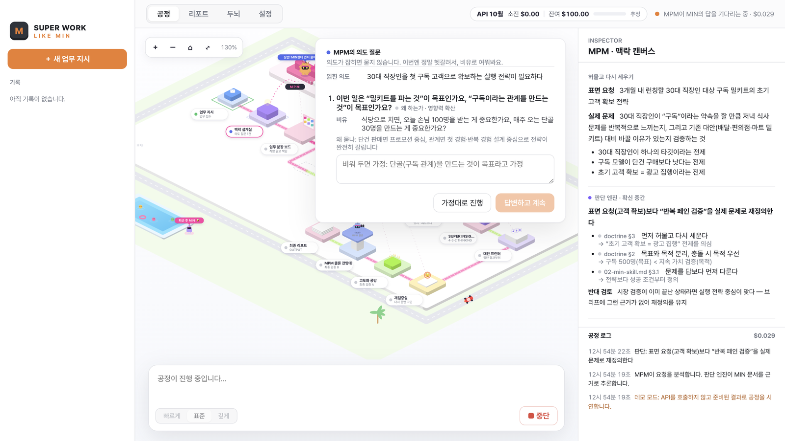<br/><sub>의도가 정말 불분명할 때만 비유로 묻는 질문 · 오른쪽에 판단 엔진 기록</sub></td>
<td width="50%">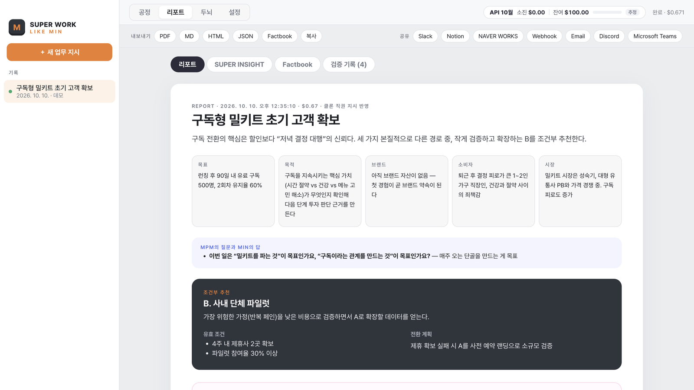<br/><sub>리포트: 코어 · MPM의 질문과 MIN의 답 · 조건부 추천</sub></td>
</tr>
</table>

### SUPER INSIGHT 방법론 툴박스

| 방법론 | 보는 것 | 잘 맞는 과제 |
| --- | --- | --- |
| **JTBD** | 고객이 '고용'하는 일, 지금 해법을 해고하게 만드는 순간, 기회 점수(중요도 + 불만족) | 서비스 기획, 신기능, 리포지셔닝 |
| **AARRR** | 획득 → 활성화 → 유지 → 매출 → 추천, 단계별 이탈 | 디지털 서비스·앱·이커머스 |
| **TOWS** | SWOT 교차(SO/ST/WO/WT)로 바로 실행할 전략 | 현황을 실무 전략으로 바꿀 때 |
| **STP 2.0** | 행동·취향 기반 세분화 → 타깃 → 포지셔닝 맵 | 신제품 출시, 광고 타깃 |
| **CDJ** | 인지 → 고려 → 구매 → 옹호, 터치포인트와 감정 곡선 | CX 개선, 브랜드 충성도 |
| **유닛 이코노믹스** | ARPU · 마진 · 이탈 · CAC → LTV, LTV/CAC, 회수 기간, 민감도 | 구독·커머스·사업성 판단 |
| **경쟁 구도** | 직접 경쟁 · 간접 경쟁 · 대체재, 위협, 비어 있는 자리 | 진입·차별화 판단 |

<table>
<tr>
<td width="50%">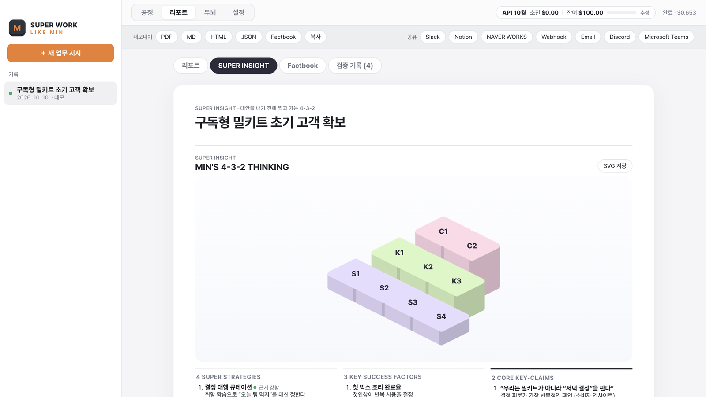<br/><sub>MIN'S 4-3-2 THINKING</sub></td>
<td width="50%">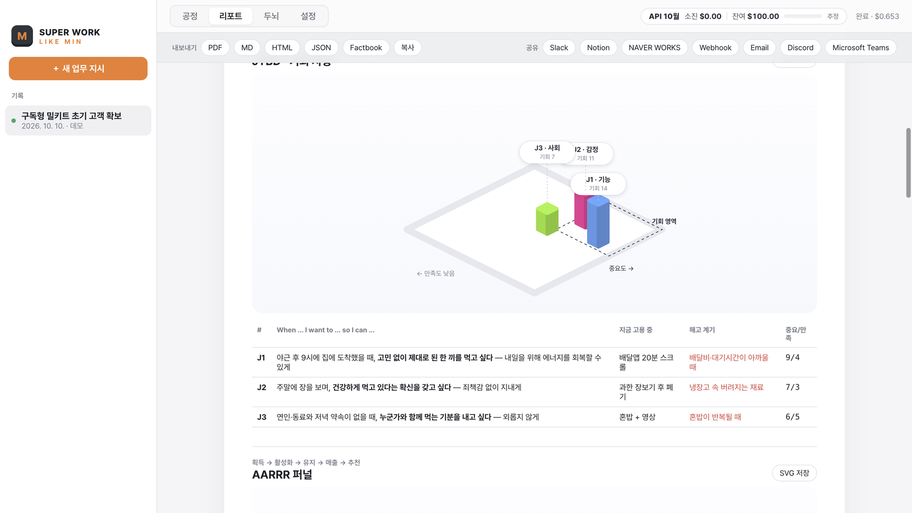<br/><sub>JTBD — 기회 지형</sub></td>
</tr>
<tr>
<td>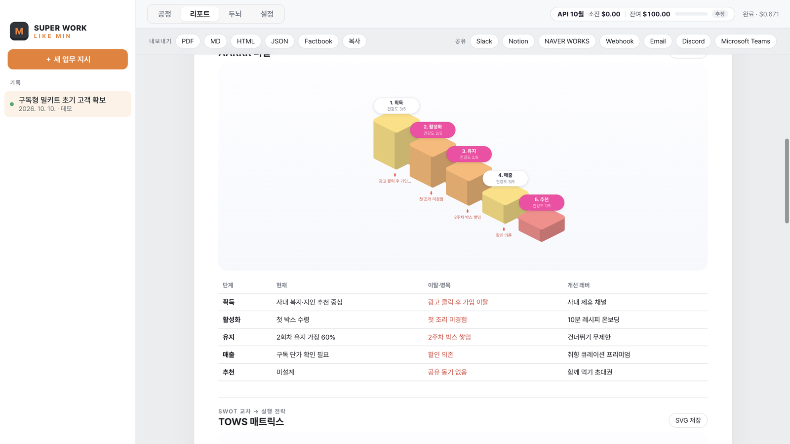<br/><sub>AARRR 퍼널 — 단계별 건강도와 이탈 구간</sub></td>
<td>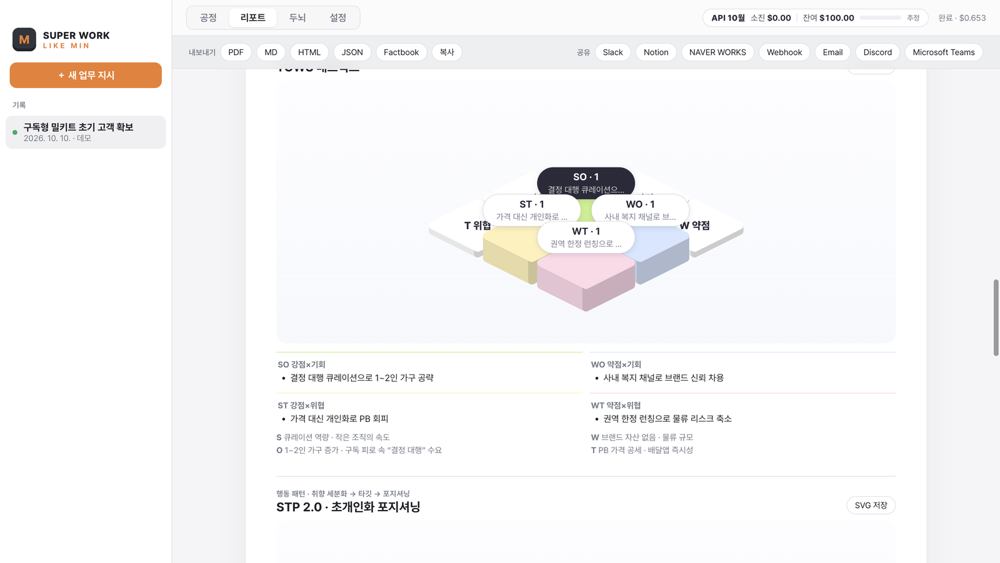<br/><sub>TOWS — SWOT 교차로 실행 전략 도출</sub></td>
</tr>
<tr>
<td>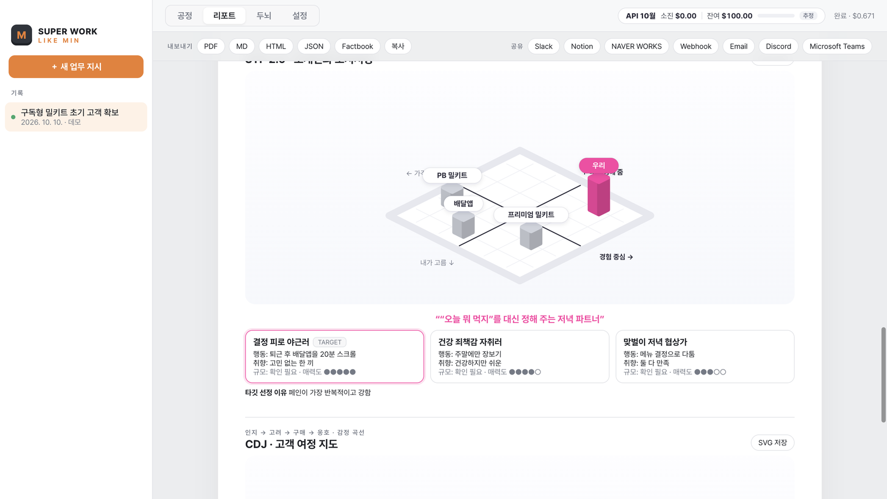<br/><sub>STP 2.0 — 행동·취향 세분화와 포지셔닝 맵</sub></td>
<td>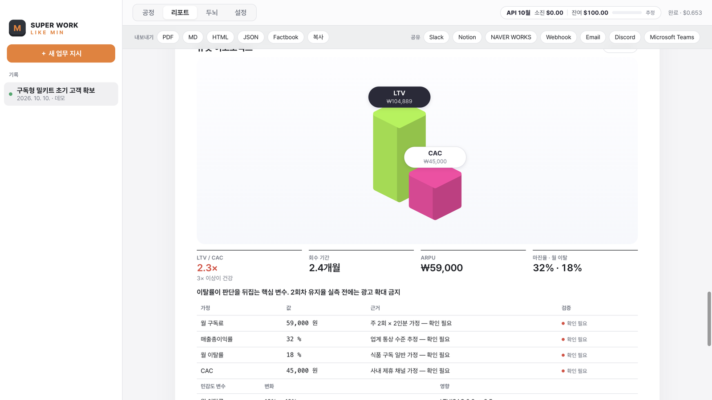<br/><sub>유닛 이코노믹스 — LTV/CAC와 가정 검증 여부</sub></td>
</tr>
<tr>
<td>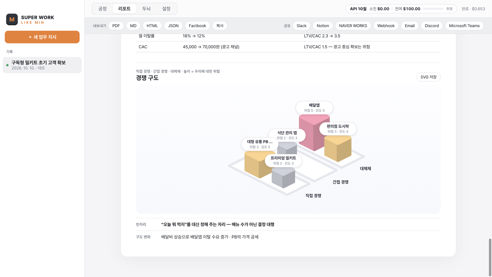<br/><sub>경쟁 구도 — 직접·간접·대체재와 비어 있는 자리</sub></td>
<td>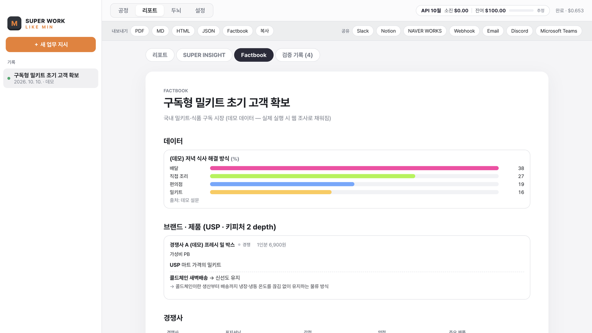<br/><sub>Factbook — 데이터, 제품 USP · 키피처 2 depth</sub></td>
</tr>
</table>

각 다이어그램은 **SVG 저장** 버튼으로 내려받아 제안서에 바로 넣을 수 있습니다.

---

## 2. 설치

### 설치파일로 설치 (권장)
[**Releases**](https://github.com/start7811dev-hub/superwork_likemin/releases/latest)에서 운영체제에 맞는 파일을 받습니다.

| OS | 파일 | 참고 |
| --- | --- | --- |
| macOS (Apple Silicon) | `SuperWork-LikeMin-x.y.z-arm64.dmg` | M1~M4 맥 |
| macOS (Intel) | `SuperWork-LikeMin-x.y.z-x64.dmg` | |
| Windows | `SuperWork-LikeMin-Setup-x.y.z.exe` | x64 · ARM64 통합 설치파일 |

> **Apple 개발자 서명 전 빌드를 처음 열 때**
> - **macOS:** DMG를 열어 앱을 **응용 프로그램** 폴더로 끌어다 놓습니다. 처음 실행할 때 "Apple은 악성 코드가 없음을 확인할 수 없습니다" 경고가 뜨면 **시스템 설정 → 개인정보 보호 및 보안**에서 **그래도 열기**를 누릅니다. 또는 터미널에서 `xattr -cr "/Applications/SUPER WORK - LIKE MIN.app"`을 실행한 뒤 엽니다.
> - v0.1.0 Apple Silicon 빌드는 서명 누락으로 "손상된 파일" 경고가 뜹니다. **v0.1.1 이상**을 받으세요.
> - **Windows:** SmartScreen 경고가 뜨면 **추가 정보 → 실행**을 누릅니다.

설치한 뒤에는 앱이 새 버전을 스스로 확인하고 받습니다. 자세한 내용은 [자동 업데이트](#자동-업데이트)를 참고하세요.

### 소스에서 실행
```bash
git clone https://github.com/start7811dev-hub/superwork_likemin.git
cd superwork_likemin
npm install
npm run dev
```
Node.js 20 이상이 필요합니다.

---

## 3. 사용법

1. **API 키 등록:** **설정 → Claude API**에 키를 넣고 **검증 후 저장**을 누릅니다. 키는 OS 보안 저장소(macOS 키체인 / Windows DPAPI)에 암호화되어 저장됩니다.
   - 키 없이 **키 없이 데모 보기**를 누르면 API를 호출하지 않고 전체 공정을 체험할 수 있습니다.
2. **업무 지시:** **공정** 탭 하단 입력창에 배경, 제약, 기한, 원하는 결과물을 자유롭게 적고 **지시하기**(⌘/Ctrl + Enter)를 누릅니다.
   - **참고 자료 첨부:** **첨부** 버튼이나 끌어다 놓기로 최대 5개까지 첨부합니다 — MD · TXT · CSV · PDF · PPTX · DOCX · XLSX · JPG · PNG · ZIP. ZIP은 안의 파일까지 읽습니다. PDF와 이미지는 MPM이 직접 보고, PPTX(노트 포함)·DOCX·XLSX는 텍스트·표로 읽습니다.
   - **링크 분석:** 지시문에 링크를 넣으면 MPM이 열어서 분석합니다. GitHub 주소는 저장소 정보·README·파일 구조·핵심 파일을 읽고, 다른 페이지는 앱 안 브라우저로 렌더링해 본문과 화면을 봅니다. 로그인이 필요한 페이지는 링크 옆 **로그인** 버튼으로 먼저 로그인하면 그 세션으로 엽니다(읽기만 함).
   - **깊이:** 빠르게(초안·방향 확인) / 표준 / 깊게(고위험 의사결정)
3. **공정 보기:** 캠퍼스에서 에이전트들이 일하는 모습을 봅니다. 스테이션을 클릭하면 오른쪽 **인스펙터**에 업무 계약, 보고, 검수 지적, 판단 엔진 기록이 나옵니다.
   - 휠·핀치로 확대, 드래그·두 손가락 스크롤로 이동, 더블클릭이나 ⌂ 버튼으로 기본 보기
   - MPM이 의도를 물으면 질문 패널에 답하거나 **가정대로 진행**을 누릅니다.
4. **리포트:** 완료되면 **리포트** 탭에서 확인합니다.
   - 탭: 리포트 / SUPER INSIGHT / Factbook / 검증 기록
   - **내보내기:** PDF · Markdown(핵심본: 결과물과 판단의 흐름) · **MD 전체**(대안 전문·시뮬레이션·Factbook·담당 보고 원문까지) · HTML · JSON · Factbook · **PPT**(Claude의 PPTX 스킬로 보고용 덱 생성, 1~3분)
   - **공유:** Slack · Notion · NAVER WORKS · Webhook · Email · Discord · Teams
5. **두뇌 학습:** 리포트 맨 아래에 **실제로 채택한 대안과 이유**를 기록하면 MPM이 다음 업무부터 MIN의 판단 성향으로 참고합니다.

상단의 **API 비용 배지**에 이번 기간의 **소진 / 잔여** 비용이 항상 표시됩니다.

---

## 4. 운영에 필요한 것

### 필수
| 항목 | 설명 |
| --- | --- |
| **Claude API 키** | [Claude Console](https://console.anthropic.com/settings/keys)에서 발급(`sk-ant-…`). 결제 수단 또는 크레딧이 필요합니다. |
| **웹 검색 허용** | Factbook 조사가 Claude의 서버 측 웹 검색을 씁니다. Console의 조직 설정에서 웹 검색이 꺼져 있으면 켜거나, 앱 설정의 **Factbook 웹 조사**를 끕니다(끄면 모델 지식으로 작성하고 신뢰도를 보수적으로 매김). |

### 선택
| 항목 | 설명 |
| --- | --- |
| **Admin API 키** (`sk-ant-admin…`) | 등록하면 비용 배지의 **소진**을 Usage & Cost Admin API의 **조직 실측 비용**으로 표시합니다. 없으면 이 앱의 호출 기록으로 추정합니다. 개인 계정에서는 발급되지 않으며, 조직 설정이 필요합니다. |
| **예산** | Claude API에는 선불 잔액을 조회하는 기능이 없습니다. 그래서 **잔여 = 예산 − 소진**으로 계산합니다. **설정 → API 비용 · 예산**에서 월 예산 또는 확인한 충전 잔액(과 확인 날짜)을 넣으세요. |
| **연동 계정** | Slack Webhook, Notion Integration, NAVER WORKS 봇 등. [5. 업무 툴 연동](#5-업무-툴-연동) 참고 |
| **GitHub 토큰** | 비공개 저장소 링크를 분석할 때만 필요합니다. 공개 저장소는 없이 됩니다. **설정 → 참고 자료 · 링크** |
| **MCP 서버** | 원격 MCP 서버(Notion · Linear · 사내 도구 등)를 등록하면 Factbook 조사에서 하위 담당이 그 도구로 자료를 찾습니다. **설정 → MCP 서버** (https 원격 엔드포인트만, 로컬 stdio 서버는 아직 지원하지 않음) |

### 모델과 비용
| 역할 | 기본 모델 | 메모 |
| --- | --- | --- |
| MPM (맥락 설계 · 검수 · SUPER INSIGHT · 종합 · 검증 · 클론) | `claude-opus-5-5` | 판단이 핵심인 단계 |
| 하위 담당 · Factbook 조사 · 시뮬레이션 | `claude-sonnet-5-5` | |
| 경량 작업 · Factbook 정리 | `claude-haiku-5-5` | |

- 한 번 실행할 때 MPM 호출이 많고(검수, 재검증, 고도화, 클론), 모든 담당이 웹 조사를 하며 결과를 최대 3회 다시 씁니다. 비용은 깊이·담당 수·재작업 횟수에 따라 달라지니 처음 몇 번은 비용 배지로 확인하세요.
- 비용을 줄이려면 **설정**에서 깊이를 "빠르게"로, 재작업을 0~1회로, 동시 작업 수를 낮추고, 필요하면 Factbook 웹 조사를 끕니다.
- 공통 두뇌(정체성·교리)는 프롬프트 캐싱으로 반복 비용을 줄입니다.
- 요청 한도(429)에 걸리면 **동시 작업 수**를 낮추세요.

### 아직 안 되는 것
- **로그인한 서비스를 직접 조작하는 것**(클릭·입력·결제 등): 지금은 로그인 세션으로 페이지를 **읽기만** 합니다. 사용자 계정으로 행동하는 기능은 단계별 승인 장치를 갖춘 뒤 추가할 예정입니다.
- **로컬 MCP 서버**(stdio): 원격 MCP 서버만 연결됩니다.

### 데이터 저장 위치
모든 데이터는 로컬에만 저장됩니다. 실행 기록, 설정, 두뇌 수정본, 결정 메모리가 여기에 있습니다.
- macOS: `~/Library/Application Support/SUPER WORK - LIKE MIN/`
- Windows: `%APPDATA%\SUPER WORK - LIKE MIN\`

API 키와 Admin 키는 이 폴더 안에 OS 암호화로 저장됩니다.

---

## 5. 업무 툴 연동

**설정 → 업무 툴 연동**에서 값을 넣고, 리포트 화면의 **공유** 버튼으로 보냅니다.

| 연동 | 필요한 값 | 보내는 내용 |
| --- | --- | --- |
| **Slack** | Incoming Webhook URL | 요약 · 조건부 추천 · 대안 목록 |
| **Notion** | Integration Token, 상위 페이지 ID (해당 페이지에 Integration 연결 필요) | 리포트 전체를 새 페이지로 |
| **NAVER WORKS** | Client ID/Secret, Service Account, Private Key(파일 경로 또는 PEM), Bot ID, Channel ID | 요약 · 2 CORE KEY-CLAIMS · 추천 · 대안 |
| **Webhook** | URL (+ Authorization 헤더) | 리포트 전체 JSON — Zapier · Make · n8n · 사내 시스템 |
| **Email** | — | 기본 메일 앱에 요약 초안 |
| **Discord / Teams** | Webhook URL | 선언형 플러그인 예시 (`plugins/integrations/`) |

### NAVER WORKS 설정
1. [NAVER WORKS Developers](https://dev.worksmobile.com/)에서 앱을 만들고 **Client ID / Client Secret**을 확인합니다.
2. 같은 앱에서 **Service Account**를 발급하고 **Private Key**를 내려받습니다. **OAuth Scope**에 `bot`을 추가합니다.
3. **Bot**을 만들고 **Bot ID**를 확인합니다. 관리자 콘솔에서 봇을 공개하고, 리포트를 받을 **메시지방에 봇을 초대**한 뒤 **Channel ID**를 확인합니다.
4. 앱 **설정 → NAVER WORKS**에 값을 넣습니다. Private Key는 파일 경로(예: `/Users/me/private_xxx.key`)나 PEM 내용 그대로 넣으면 됩니다.

> 인증 흐름: 서비스 계정 JWT(RS256) → `auth.worksmobile.com/oauth2/v2.0/token` → `worksapis.com/v1.0/bots/{botId}/channels/{channelId}/messages`

### 코드 없이 연동 추가하기
`plugins/integrations/*.json` 형식의 파일을 **설정 → 플러그인 폴더 열기**에 넣으면 새 연동이 생깁니다. 형식은 [discord.json](plugins/integrations/discord.json)을 참고하세요. 문자열의 `{{title}}`, `{{summary}}`, `{{recommendation}}`, `{{markdown}}`, `{{report}}`, 그리고 각 필드 key가 치환됩니다.

---

## 6. 두뇌(LIKE MIN Brain) 키우기

```
brain/
  identity/      MIN의 자기 분석 · 맥락 운영 방법론 (판단 엔진의 근거 · 저장소 비공개, 릴리스 빌드 때 Secrets에서 주입)
  doctrine.md    MPM 운영 교리: MIN 체크표, 의도 파악, 판단 엔진, 작업 리듬, 위임, Factbook, 공정 설계, 검수, 대안 규칙
  roster.json    MPM이 분장할 수 있는 하위 담당 (역할·관점·모델 등급)
  knowledge/     추가 지식 (*.md는 전부 주입됨)
```

- 앱의 **두뇌** 탭에서 교리와 담당 구성을 고치거나 지식 파일을 추가할 수 있습니다. 수정본은 사용자 데이터 폴더에 저장되어 앱을 업데이트해도 유지되고, 번들 두뇌는 앱 업데이트와 함께 갱신됩니다.
- **결정 메모리:** 리포트에 기록한 실제 채택 결정 중 최근 8개를 MPM이 참고합니다.

---

## 7. 개발 · 배포 · 자동 업데이트

```bash
npm run dev          # 개발 실행
npm run typecheck    # 타입 검사
npm run dist:mac     # 로컬에서 macOS 설치파일 빌드 → release/
npm run dist:win     # 로컬에서 Windows 설치파일 빌드
```

### 릴리스 (자동 업데이트)
```bash
npm version patch     # package.json 버전 올리기 + 태그 생성 (예: v0.1.1)
git push --follow-tags
```
`v*` 태그를 푸시하면 [Release 워크플로](.github/workflows/release.yml)가 GitHub Actions에서 초안 릴리스를 만들고, macOS·Windows 설치파일을 빌드해 그 초안에 올린 뒤, 모두 올라가면 **GitHub Releases**에 공개합니다. 설치된 앱은 시작할 때(그리고 **설정 → 업데이트 확인**에서) 새 버전을 확인합니다. 새 버전은 백그라운드에서 받고, **재시작하여 설치**로 적용합니다.

| 플랫폼 | 자동 업데이트 조건 |
| --- | --- |
| Windows | 서명 없이도 동작합니다. 코드 서명 인증서가 있으면 SmartScreen 경고가 사라집니다. |
| macOS | **Apple Developer ID 서명이 있어야** 자동 업데이트가 동작합니다. 서명이 없으면 새 버전을 Releases에서 직접 받아 설치합니다. |

**GitHub Secrets**
| Secret | 용도 |
| --- | --- |
| `MIN_IDENTITY_01_B64`, `MIN_IDENTITY_02_B64` | **필수.** MIN 자기 분석 원문(base64). 공개 저장소에 올리지 않고 릴리스 빌드 때만 주입 — [brain/identity/README.md](brain/identity/README.md) |
| `MAC_CERT_P12_BASE64`, `MAC_CERT_PASSWORD` | 선택. Developer ID Application 인증서(.p12, base64) |
| `APPLE_ID`, `APPLE_APP_SPECIFIC_PASSWORD`, `APPLE_TEAM_ID` | 공증(notarization) |
| `WIN_CERT_P12_BASE64`, `WIN_CERT_PASSWORD` | Windows 코드 서명 |

인증서 시크릿(`MAC_CERT_P12_BASE64`)이 있으면 워크플로가 **Developer ID 서명 + Apple 공증**을 자동으로 켭니다. 이때부터 macOS에서도 경고 없이 열리고 자동 업데이트가 동작합니다. 시크릿이 없으면 임시(ad-hoc) 서명으로 빌드합니다.

<details>
<summary><b>Developer ID 인증서 받기 · 시크릿 등록 방법</b></summary>

1. Xcode → **Settings → Accounts**에서 Apple ID로 로그인 → 팀 선택 → **Manage Certificates…** → 왼쪽 아래 **+** → **Developer ID Application** (팀의 Account Holder만 만들 수 있습니다)
2. **키체인 접근** → 로그인 → 내 인증서 → `Developer ID Application: …`을 우클릭 → **내보내기** → `.p12`로 저장하고 암호 지정
3. [appleid.apple.com](https://appleid.apple.com) → 로그인 및 보안 → **앱 암호** 생성 (공증용)
4. [developer.apple.com/account](https://developer.apple.com/account) → 멤버십 세부 사항에서 **Team ID** 확인
5. 저장소 폴더에서 시크릿 등록 (값은 프롬프트에 직접 입력):
   ```bash
   base64 -i DeveloperID.p12 | gh secret set MAC_CERT_P12_BASE64
   gh secret set MAC_CERT_PASSWORD
   gh secret set APPLE_ID
   gh secret set APPLE_APP_SPECIFIC_PASSWORD
   gh secret set APPLE_TEAM_ID
   ```
</details>

### 개발용 화면 캡처
```bash
npm run build && SWLM_SHOT_DIR=./shots npx electron .
```
임시 데이터 폴더에서 데모를 자동 실행하며 단계별 화면을 PNG로 저장합니다. 이 README의 스크린샷이 이렇게 만들어졌습니다.

---

## 8. 구조

```
src/main/
  engine/pipeline.ts   공정 오케스트레이터 (의도 질문 → 분장·위임 → Factbook+업무⇄검수 → 통합 → 시뮬레이션
                       → SUPER INSIGHT → 전략 종합 → 재검증 → 콘셉트 회차(리뷰 카드) → 고도화(회차를 전략으로) → 1장 브리프 → 제작 → 취향 심사 → 윤문 → 전달, 단계별 실행·생략은 MPM 판단)
  engine/prompts.ts    단계별 업무 계약 (책임 · 판단 기준 · 경계 · 판단 엔진 규칙)
  engine/claude.ts     Claude API: structured outputs, 서버 측 거절 폴백, 웹 검색, MCP 커넥터, PPTX 스킬, 사용량 집계
  engine/demo.ts       키 없이 체험하는 데모 엔진
  brain/loader.ts      번들 두뇌 + 사용자 오버레이 + 결정 메모리
  materials/           참고 자료: 첨부 파일 파서(PDF·이미지·PPTX·DOCX·XLSX·ZIP), 링크 분석(GitHub API·렌더링·로그인 세션)
  cost.ts              비용 모니터 (Cost Admin API 실측 / 로컬 추정, 예산 대비 잔여)
  secrets.ts           GitHub 토큰·MCP 토큰 암호화 저장
  export/              PDF · MD · HTML · JSON · Factbook 내보내기
  integrations/        Slack · Notion · NAVER WORKS · Webhook · Email + JSON 플러그인
  updater.ts           electron-updater (GitHub Releases)
src/shared/schemas.ts  모든 단계의 출력 스키마 (단일 기준)
src/renderer/
  components/Factory.tsx      아이소메트릭 캠퍼스 (에이전트 캐릭터, 파이프라인, 확대·이동)
  components/StrategyViz.tsx  SUPER INSIGHT 다이어그램 (4-3-2 · JTBD · AARRR · TOWS · STP · CDJ · 유닛 이코노믹스 · 경쟁 구도)
  components/iso.tsx          아이소메트릭 드로잉 키트 (공정 · 전략 시각화 공용)
```

| 확장 대상 | 위치 |
| --- | --- |
| 하위 담당 추가 | `brain/roster.json` 또는 두뇌 탭 |
| 연동 추가 (코드 없이) | `plugins/integrations/*.json` |
| 연동 추가 (코드) | `src/main/integrations/index.ts`의 `Integration` |
| 내보내기 형식 | `src/main/export/index.ts`의 `EXPORTERS` |
| 공정 단계 | `pipeline.ts` + `schemas.ts` + `Factory.tsx` 레이아웃 |
| 분석 방법론 | `METHODS` · `InsightSchema` (schemas.ts) + `prompts.ts`의 `ROLE.insight` + `StrategyViz.tsx` |
